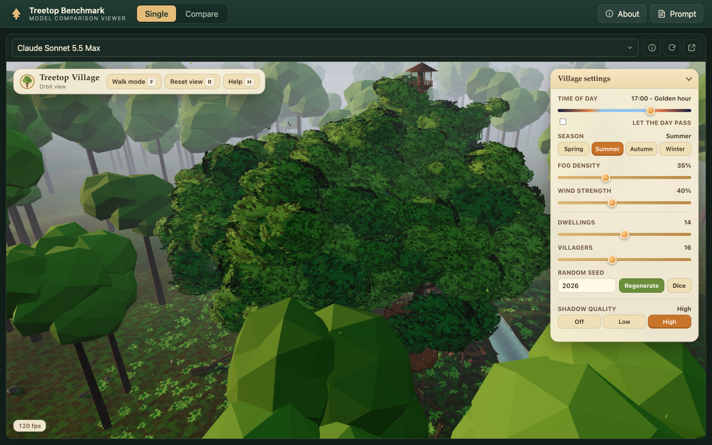
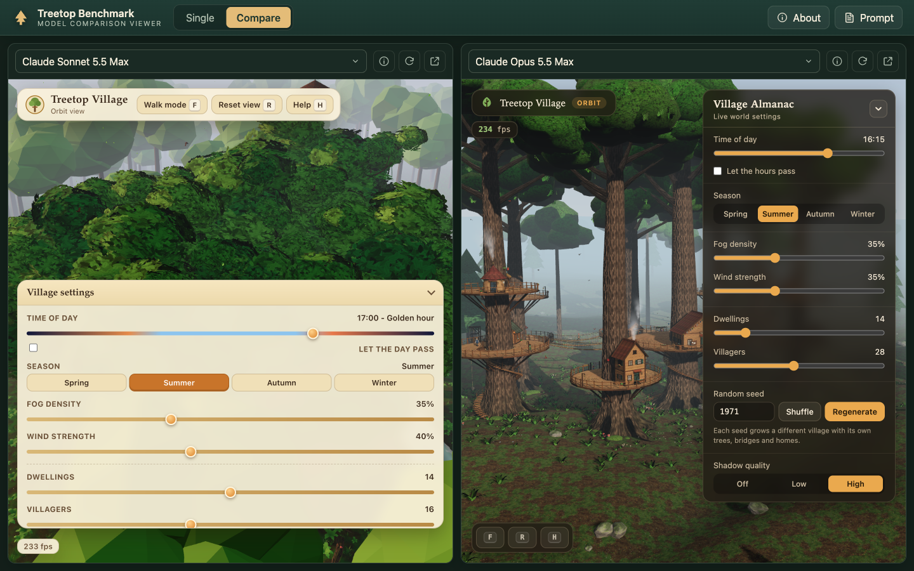
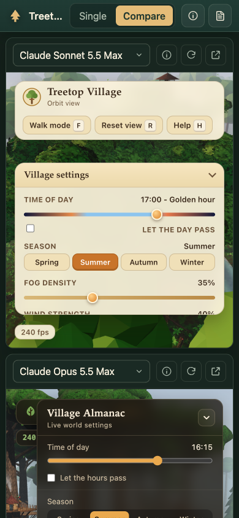

<div align="center">

# 🌲 Treetop Benchmark Viewer

### Browse and compare the 3D treetop villages your models build, side by side.

A fast, zero-dependency static viewer for judging the single-file HTML scenes produced by the Treetop benchmark.
Load any model full screen, or put two next to each other and let your eyes do the scoring.
Runs entirely in the browser, so it hosts on GitHub Pages as is.

**[Open the live viewer](https://markstent.github.io/treetop_benchmark/)**

<br />

[](https://www.python.org/)
[](#why-its-fast-and-simple)
[](https://threejs.org/)
[](app.js)
[](https://markstent.github.io/treetop_benchmark/)
[](LICENSE)

</div>

<br />

<div align="center">
  
</div>

<br />

## Contents

- [The benchmark](#the-benchmark)
- [Models in this repo](#models-in-this-repo)
- [What it does](#what-it-does)
- [Quick start](#quick-start)
- [Usage](#usage)
- [Screenshots](#screenshots)
- [Hosting on GitHub Pages](#hosting-on-github-pages)
- [Adding a model](#adding-a-model)
- [Generating a model run](#generating-a-model-run)
- [How it works](#how-it-works)
- [Project layout](#project-layout)
- [Development](#development)
- [License](#license)

<br />

## The benchmark

One brief, one shot, one file.
Each model receives [`prompt.txt`](prompt.txt) and must answer with a single self-contained HTML page that renders an interactive, highly detailed 3D treetop village:
at least seven giant trees, a dozen varied dwellings, swaying rope bridges, a living forest floor, animated villagers, a day/night and seasons control panel, orbit and first-person camera modes, zero console errors, and a steady 60 fps, all generated procedurally with three.js r170 and no external assets.

The model never gets to run its code.
What it hands back is what you see in the viewer.

**[docs/BENCHMARK.md](docs/BENCHMARK.md)** explains the purpose of the benchmark, what the brief demands, which abilities it exercises, and what the results make visible.
The same text is one click away inside the viewer under **About**, and the brief itself under **Prompt**.

### Rules every run follows

- The brief is sent verbatim as the only user message. No system prompt, no hints, no follow-up.
- Reasoning effort is set to the highest level the model supports, and that level is recorded in the filename, for example `_High` or `_Max`.
- Output is taken as delivered. Markdown fences and chatter around the document are stripped, nothing inside it is changed.
- If a file is ever edited after generation, the edit is described in that model's note in `models.json` and shown in the viewer's info panel.

<br />

## Models in this repo

| Model | Effort | Run | Notes |
| --- | --- | --- | --- |
| Claude Sonnet 5.5 | max | 2026-10-18 | As generated, no edits. Zero console errors on first load. |
| Claude Opus 5.5 | max | 2026-10-18 | Patched after generation: four calls to a Vector3 method on a three.js Color replaced with equivalent Color arithmetic. As generated it crashed during construction. |
| Claude Fable 5.1 | max | 2026-10-18 | Patched after generation: nine GLSL `#include` directives moved onto their own lines. As generated the water and particle shaders failed to compile. |
| GPT6 Astra | high | 2026-10-01 | Legacy baseline added before any tooling existed. Settings were not recorded. |

The Claude runs were made through Claude Code subagents on an Anthropic subscription.
Each is a single sample; model output varies between runs.
The same information, including the provider for each run, is in `models.json` and behind the info button on every panel.

<br />

## What it does

Each model run in this benchmark is a single, self-contained HTML file: an interactive 3D treetop village built with three.js, generated entirely in code with no external assets.
Comparing a dozen of these by hand means juggling browser tabs and losing track of which is which.

This viewer fixes that.

- 🪟 **Single mode** puts one model full screen so you can explore it in detail.
- ⚖️ **Compare mode** places two models side by side, each with its own picker, so differences jump out.
- 📱 **Fully responsive**, from an ultrawide monitor down to a phone: the compare panels stack and the chrome collapses gracefully.
- 🔄 **Reload** restarts a scene in place, handy for re-rolling a random seed.
- ↗️ **Open in new tab** launches a model on its own for a true full-window performance test.
- 📜 **Prompt panel** keeps the full benchmark brief one click away while you judge.
- ℹ️ **About panel** opens the benchmark write-up inside the viewer, so the purpose is never far from the models.
- ℹ️ **Per-run provenance**: every panel has an info button showing the model, provider, effort, date, and any notes for that file.
- 🔒 **Sandboxed scenes**: each model runs in a sandboxed iframe with no access to the page around it.
- 🌐 **Static**: no backend. A `models.json` manifest lists the models, so the whole site deploys to GitHub Pages.

<br />

## Quick start

The site is static files at the repository root, so any static file server works.
A tiny one is included so nothing needs installing.

> **Requirement:** Python 3.10 or newer. Nothing else. No `pip install`, no `npm install`.

```bash
# from the project root
python3 server.py
```

Then open the URL it prints:

```
http://localhost:8777/
```

Prefer a different port? Pass it as an argument:

```bash
python3 server.py 9000
```

The included server only exposes the viewer, its data, the model files, `docs/`, and `assets/`.
Scripts, tests, `runs/`, and `.env` are never served.

<br />

## Usage

| Control | What it does |
| --- | --- |
| **Single / Compare** | Switch between one full-screen model and two side by side. |
| **Model dropdown** | Choose which model fills a panel. Each panel is independent. |
| **ℹ️ Info** | Show the provenance of the model in that panel: model id, provider, effort, run date, and notes. |
| **🔄 Reload** | Restart that model's 3D scene in place. |
| **↗️ Open in new tab** | Open the raw model on its own for full-window testing. |
| **ℹ️ About** | Slide out the benchmark write-up (`docs/BENCHMARK.md`): its purpose, what it covers, and what it shows. |
| **📜 Prompt** | Slide out the full benchmark prompt. Dismiss with the close button, the backdrop, or `Esc`. |

Every model renders inside its own sandboxed `<iframe>`, so two scenes run fully isolated, each with its own WebGL context, and neither can touch the other or the app shell.

<br />

## Screenshots

**Compare mode** - two independent scenes, each with its own controls:

<div align="center">
  
</div>

<br />

**Responsive** - the same app on a phone, panels stacked and chrome collapsed:

<div align="center">
  
</div>

<br />

## Hosting on GitHub Pages

1. In the repository settings, enable Pages from the `main` branch, root folder.
2. That is it. The site is live at `https://<user>.github.io/<repo>/`.

Everything the page needs is a relative URL, so it works from a project sub-path as well as from a custom domain.
A `.nojekyll` file at the root stops Pages from pre-processing the Markdown write-up, which the About panel fetches raw.

<br />

## Adding a model

The viewer reads `models.json`, a small manifest that lists each file with its label and provenance.

```json
{
  "file": "Treetop_village_Claude_Opus_5.5_Max.html",
  "label": "Claude Opus 5.5 Max",
  "model": "claude-opus-5-5",
  "provider": "Claude Code subagent (Anthropic subscription)",
  "effort": "max",
  "date": "2026-10-18",
  "note": "Anything a viewer should know about this run."
}
```

Two ways to add an entry:

- **Generate the run** with `generate.py` (below). It writes the file and the manifest entry in one go.
- **Drop a file in** `models/` and run `python3 generate.py --sync-manifest`. Files without an entry are added with a label derived from the filename, entries whose file is gone are removed, and anything you wrote by hand is kept.

Labels derive from filenames when not given.
A leading `Treetop_village_` prefix is stripped, the extension is dropped, and underscores become spaces:

```
Treetop_village_GPT6_Astra_High.html   ->   GPT6 Astra High
```

<br />

## Generating a model run

`generate.py` runs the benchmark prompt against any model and drops the result straight into `models/`.
Every model is treated identically, so the files are directly comparable.

```bash
# via a LiteLLM proxy (default): reads LITELLM_API_KEY and LITELLM_BASE_URL
python3 generate.py claude-opus-5.5 --reasoning max

# via OpenRouter: reads OPENROUTER_API_KEY
python3 generate.py openai/gpt-6-astra --provider openrouter --reasoning high --label "GPT6 Astra"
```

Keys come from the environment or from a gitignored `.env` in the project root.
Copy `.env.example` to get started.

What "treated identically" means:

- `prompt.txt` is sent verbatim as the only user message, with no system prompt.
- Reasoning effort is whatever you pass with `--reasoning`, and it is appended to the filename, as in `_High`. The benchmark rule is the highest level the model supports, so pass it every time; without the flag the provider default is used and no suffix is added.
- The reply is streamed, then cut to the span from the first `<!DOCTYPE html>` to the last `</html>`.
  Markdown fences and any chatter around the document are discarded and the trimmed character counts are reported.
- The file is saved as `models/Treetop_village_<Label>[_<Effort>].html` and an entry is added to `models.json`. The label is derived from the model id unless you pass `--label`.
- The untouched raw reply and a `meta.json` with timing, token usage, cost, finish reason, and trim counts go to `runs/<same name>/`.
- A reply that hit the token limit, or contains no complete HTML document, is refused and nothing is written to `models/`.
  The raw reply is still kept so you can see what happened.
- An existing model file is never overwritten unless you pass `--force`.

Run `python3 generate.py --help` for all options. The unit tests live in `tests/` and run with `python3 -m unittest`.

<br />

## How it works

The whole app is three static files plus a JSON manifest. There is no backend.

```
Browser  ──GET index.html + style.css + app.js ──▶  the viewer shell
         ──GET models.json ─────────────────────▶  list of models with provenance
         ──GET models/<file> ───────────────────▶  the raw model HTML (loaded in a sandboxed iframe)
         ──GET prompt.txt ──────────────────────▶  the benchmark brief (Prompt panel)
         ──GET docs/BENCHMARK.md ───────────────▶  the write-up (rendered in the About panel)
```

### Why it's fast and simple

- **Zero third-party dependencies.** The frontend is vanilla HTML, CSS, and JavaScript with no framework and no build step. The optional local server is pure Python standard library.
- **Static by design.** Every URL is relative and every data source is a committed file, so GitHub Pages serves it unchanged.
- **Isolation by design.** Each model is a full HTML document rendered in an `<iframe>` with the `sandbox` attribute, giving every scene its own origin, window, and WebGL context.
- **Safe by default.** The local server only serves the viewer, `models/`, `docs/`, and `assets/`, and rejects directory-traversal paths.

<br />

## Project layout

```
treetop_benchmark/
├── index.html                # app shell (served as the site root)
├── style.css                 # warm, dark, canopy-themed UI
├── app.js                    # model loading, modes, panels, Markdown rendering
├── models.json               # manifest: which models to show, with provenance
├── models/                   # the model .html files
│   └── Treetop_village_*.html
├── prompt.txt                # the benchmark prompt
├── docs/
│   ├── BENCHMARK.md          # purpose of the benchmark, what it covers and shows
│   └── superpowers/specs/    # design specs
├── assets/                   # screenshots for this README and link previews
├── .nojekyll                 # tell GitHub Pages to serve files as they are
├── server.py                 # optional local static server (stdlib only)
├── generate.py               # run the prompt against any model, update the manifest
├── tests/                    # unit tests for generate.py
├── runs/                     # raw replies + metadata per run (gitignored)
├── .env.example              # API key template; copy to .env
├── LICENSE
└── README.md
```

<br />

## Development

```bash
python3 -m unittest            # unit tests for generate.py (no network needed)
python3 server.py              # preview the site locally
python3 generate.py --help     # all generator options
```

There is no build step and nothing to install.
Edit `index.html`, `style.css`, or `app.js` and reload.
`docs/superpowers/specs/` holds the design notes for the viewer and the generator.

<br />

## License

The viewer, generator, and documentation are released under the [MIT License](LICENSE).
The files in `models/` are model-generated outputs included for comparison.

<br />

<div align="center">
  <sub>Built for the Treetop benchmark · <a href="https://github.com/markstent/treetop_benchmark">github.com/markstent/treetop_benchmark</a></sub>
</div>
